<div align="center">

  <!-- Hero Banner -->
  

  <br/><br/>

  <!-- Dynamic Typing SVG Header -->
  <a href="https://github.com/Jillurcf">
    
  </a>

  <p align="center">
    <strong>Architecting deterministic intelligence, high-performance mobile systems, and scalable cloud applications.</strong>
  </p>

  <!-- Core Focus Badges -->
  <p align="center">
    <a href="https://github.com/Jillurcf"></a>
    <a href="https://github.com/Jillurcf"></a>
    <a href="https://github.com/Jillurcf"></a>
    <a href="https://github.com/Jillurcf"></a>
    <a href="https://github.com/Jillurcf"></a>
  </p>

  <!-- Quick Social Links -->
  <p align="center">
    <a href="mailto:jrtushar@gmail.com"></a>
    <a href="https://github.com/Jillurcf"></a>
    <a href="https://linkedin.com/in/jillur-rahman"></a>
    <a href="https://github.com/Jillurcf/jillur_professional_portfolio"></a>
  </p>

</div>

---

### 👨‍💻 Executive Summary

I am an **AI-First Software Engineer** dedicated to bridging probabilistic artificial intelligence with robust, deterministic distributed systems. My focus centers on **Context Engineering**, multi-agent automation workflows, cross-platform mobile architecture with **React Native**, and production-grade full-stack platforms powered by **TypeScript** and **Next.js**.

I design systems where AI isn't an afterthought or a simple wrapper—it's an integrated architectural layer engineered around token economics, high-precision retrieval, schema-enforced tool execution, and resilient user interfaces.

```ascii
┌────────────────────────────────────────────────────────────────────────┐
│                        AI-FIRST SYSTEM TOPOLOGY                        │
├────────────────────────────────────────────────────────────────────────┤
│  Client Layer       │  React Native (Mobile)  │  Next.js 14+ (Web)     │
│  State & Contract   │  TypeScript  •  Zod  •  TanStack  •  Zustand     │
│  Context & Agents   │  Context Compression  •  RAG  •  Tool Calling    │
│  Core Backend       │  Node.js / Express  •  Server Actions  •  REST   │
│  Data & Cache       │  PostgreSQL  •  MongoDB  •  Redis  •  Vectors    │
└────────────────────────────────────────────────────────────────────────┘
```

---

### 🚀 Core Engineering Pillars

<table>
  <tr>
    <td width="50%" valign="top">
      <h4>🧠 Context Engineering & AI Agents</h4>
      <ul>
        <li><strong>Context Window Architecture:</strong> Semantic compression, precision retrieval matrices, and prompt distillation to minimize token costs and eliminate latency.</li>
        <li><strong>Autonomous Agent Workflows:</strong> Deterministic tool dispatching, human-in-the-loop patterns, multi-agent collaboration, and self-correcting execution loops.</li>
        <li><strong>RAG & Vector Retrieval:</strong> Hybrid keyword-dense search, chunking strategies, embeddings, and vector indexing for real-time contextual grounding.</li>
        <li><strong>Structured Output & Guardrails:</strong> Strict JSON-schema enforcement, validation pipelines with Zod, and output sanitization.</li>
      </ul>
    </td>
    <td width="50%" valign="top">
      <h4>📱 High-Performance Mobile (React Native)</h4>
      <ul>
        <li><strong>Cross-Platform Excellence:</strong> Production React Native and Expo architectures running at 60/120fps with native gesture handling.</li>
        <li><strong>State & Offline Synchronization:</strong> Resilient offline-first persistence, optimistic mutations, background sync, and cache reconciliation.</li>
        <li><strong>Native Bridge & Modules:</strong> Seamless bridging between TypeScript and native platform APIs (iOS/Android).</li>
        <li><strong>Performance Profiling:</strong> Memory leak eradication, JS thread optimization, and native bundle size reduction.</li>
      </ul>
    </td>
  </tr>
  <tr>
    <td width="50%" valign="top">
      <h4>⚡ Full-Stack & Modern Web (Next.js)</h4>
      <ul>
        <li><strong>Next.js App Router:</strong> Server Components (RSC), Streaming SSR, Suspense boundaries, and Server Actions for minimal client bundles.</li>
        <li><strong>End-to-End Type Safety:</strong> Unified TypeScript schemas shared across clients, servers, and database queries.</li>
        <li><strong>Design Systems & UX:</strong> Tailwind CSS, modular component libraries, fluid micro-interactions, and accessibility (a11y).</li>
        <li><strong>API Design:</strong> Scalable RESTful endpoints, streaming responses (SSE), WebSockets, and secure authentication flows.</li>
      </ul>
    </td>
    <td width="50%" valign="top">
      <h4>🏛️ System Design & Distributed Scale</h4>
      <ul>
        <li><strong>Domain-Driven Design (DDD):</strong> Decoupled, modular services built for horizontal scale and zero-downtime deployment.</li>
        <li><strong>High-Throughput Caching:</strong> Multi-tier caching with Redis, stale-while-revalidate strategies, and database indexing.</li>
        <li><strong>Relational & NoSQL Storage:</strong> PostgreSQL schema modeling, Prisma/TypeORM, MongoDB document design, and vector databases.</li>
        <li><strong>DevOps & Automation:</strong> Dockerized environments, automated CI/CD workflows with GitHub Actions, and cloud deployment pipelines.</li>
      </ul>
    </td>
  </tr>
</table>

---

### 🛠️ Technical Stack & Tooling Matrix

<div align="center">

| Domain | Technologies & Frameworks |
| :--- | :--- |
| **AI & Context Engineering** | `Prompt Engineering` `Context Distillation` `Tool Calling` `RAG Pipelines` `LangChain` `LlamaIndex` `Vercel AI SDK` `Vector DBs` |
| **Mobile Development** | `React Native` `Expo` `TypeScript` `React Navigation` `Reanimated` `Gesture Handler` `Zustand` `Redux Toolkit` |
| **Frontend & Web** | `Next.js (App Router)` `React.js` `TypeScript` `JavaScript (ESNext)` `Tailwind CSS` `HTML5 / CSS3` |
| **Backend & APIs** | `Node.js` `Express.js` `RESTful APIs` `Server Actions` `Edge Functions` `WebSockets / SSE` |
| **Databases & Cache** | `PostgreSQL` `MongoDB` `Redis` `Supabase` `Firebase` `Pinecone / Vector Stores` |
| **DevOps & Architecture** | `Docker` `Git & GitHub` `GitHub Actions (CI/CD)` `Postman` `System Design` `Linux` `Vercel` |
| **Design & Prototyping** | `Figma` `UI/UX Systems` `Wireframing` `Responsive Design` |

<br/>

<a href="https://skillicons.dev">
  
</a>

</div>

---

### 🧩 Engineering Philosophy

```
  ┌──────────────────────┐      ┌──────────────────────┐      ┌──────────────────────┐
  │   1. Context First   │      │ 2. Deterministic AI  │      │ 3. Resilient Systems │
  ├──────────────────────┤      ├──────────────────────┤      ├──────────────────────┤
  │ Treat LLM context as │ ───> │ Enforce structured   │ ───> │ Build fault-tolerant │
  │ a scarce cache: high │      │ schemas, tool loops, │      │ offline-first apps   │
  │ signal, low tokens.  │      │ and zero hallucinate │      │ and robust backends. │
  └──────────────────────┘      └──────────────────────┘      └──────────────────────┘
```

1. **Context as an Economic Asset**: Context windows are not infinite dumps. High-performance AI systems require semantic pruning, prompt distillation, and targeted retrieval to preserve reasoning quality while cutting token latency.
2. **Deterministic Guardrails on Probabilistic Engines**: LLMs provide creative inference; software architecture provides certainty. Every agent action is validated with strict type contracts, schema validations, and idempotent fallbacks.
3. **Uncompromising Developer Experience & Type Safety**: When data contracts never break between client, server, and model, delivery speed accelerates and runtime regressions drop to zero.
4. **Performance as a Core Feature**: From 120Hz mobile UI frame budgets to sub-100ms server edge responses, speed is an unnegotiable system requirement.

---

### 📊 GitHub Activity & Real-Time Telemetry

<div align="center">

  <table border="0">
    <tr>
      <td align="center" width="50%">
        
      </td>
      <td align="center" width="50%">
        
      </td>
    </tr>
  </table>

  <br/>

  <a href="https://git.io/streak-stats">
    
  </a>

</div>

---

### 🤝 Let's Connect & Collaborate

I am always keen to discuss **AI-first architectures, autonomous agents, cross-platform mobile engineering, and system design challenges**. Whether you're building a groundbreaking startup, scaling an enterprise product, or looking for high-level engineering leadership:

<div align="center">

  <a href="mailto:jrtushar@gmail.com">
    
  </a>
  &nbsp;
  <a href="https://linkedin.com/in/jillur-rahman">
    
  </a>
  &nbsp;
  <a href="https://github.com/Jillurcf">
    
  </a>

  <br/><br/>

  <sub>Designed with precision for <strong>Jillur Rahman</strong> • Engineered with an <strong>AI-First</strong> mindset ⚡</sub>

</div>
